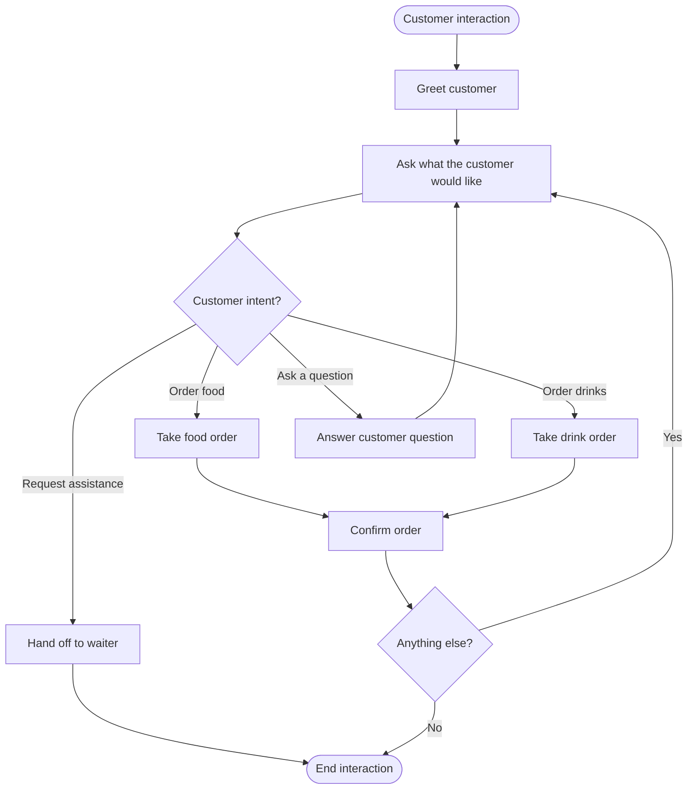
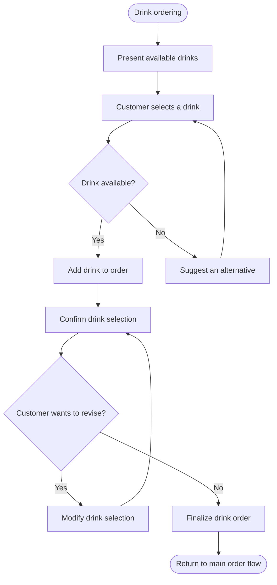
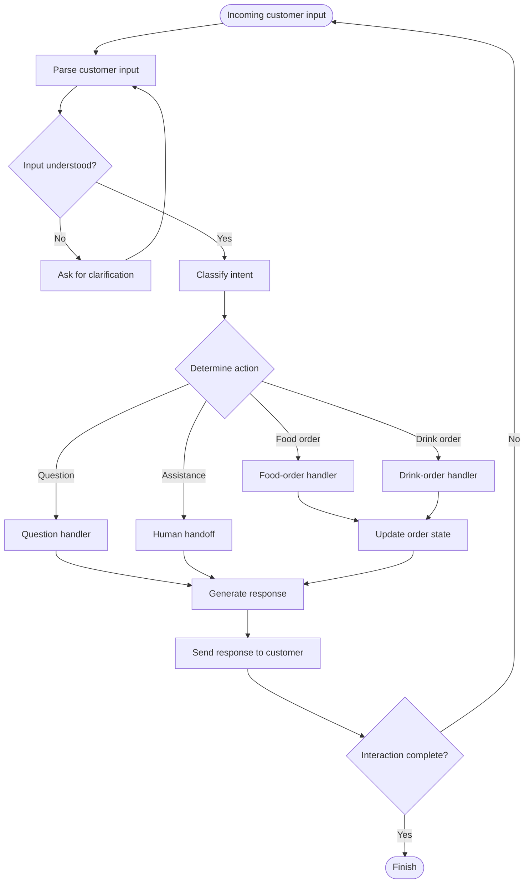

# Restaurant Dialogue Flowcharts

This document contains three Mermaid flowcharts describing the restaurant interaction logic, drink ordering and confirmation flow, and implementation rules.

---

## 1. Customer Intent and Order Flow

---

## 2. Drinks, Confirmation and Order Revisions

---

## 3. Implementation Rules

